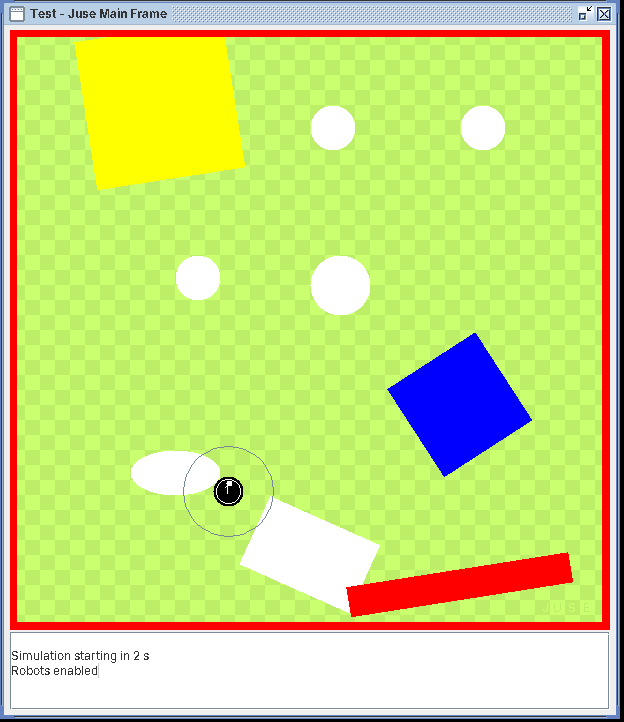
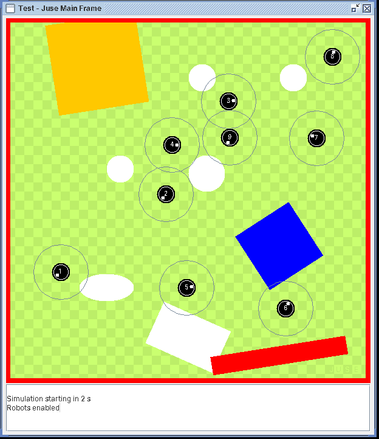
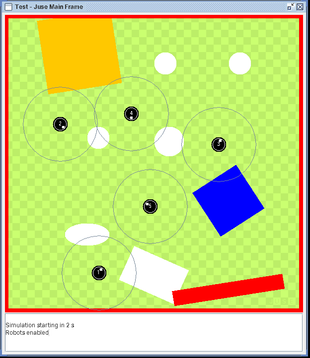

# JUSE

> **This is the historical version of JUSE (2008–2011).**
> Development continues in **[Pianura](https://github.com/raffaeleGrandi/Pianura)**, its modern evolution.
>
> Tidied up in 2026 (debug comments removed, folders reorganized), no functional changes; the untouched original is at tag `v2011-original`.

author: Raffaele Grandi
period: April 2008 - July 2011
description: 
Java UniBot Simulation Environment (J.U.S.E.) was designed as a stand-alone simulator for differential wheeled mobile robots, self-made and completely based on Java technologies. The basic idea of J.U.S.E. was to create the simulation counterpart of the real robot Unibot, where users had the possibility to test algorithms on their computers before testing them on real robots. From the earliest versions of J.U.S.E., each simulated robot was designed as an agent, considered in the meaning of Multi Agents System terminology, with different layers of computation, from the logical to the physical one. At the beginning J.U.S.E. was developed as a support to my master thesis but the simplicity of the environment and the java-based architecture was a good choice in order to adopt J.U.S.E. as an instrument in the courses of Robotics and Artificial
Intelligence and for many other thesis.

## Screenshots

| One robot avoiding obstacles (scenario 04) | Nine robots, original controller (scenario 05) | Five Braitenberg vehicles (scenario 06) |
|---|---|---|
|  |  |  |

The thin circle around each robot is its infrared sensing range. Scenarios 05 and 06
were added in 2026; see below.

## Repository layout

| Folder | Contents |
|---|---|
| `src/` | the simulator itself (`jusePack`), as it was in 2011 |
| `algorithms/` | robot controllers that run on JUSE: [index](algorithms/README.md) |
| `examples/` | scenarios that put them to work: [index](examples/README.md) |
| `docs/img/` | the screenshots above |

The examples used to live inside `src/` (`testRobots3`, `testRobots4`). They are now
`examples/scenario03` and `examples/scenario04`, and their controllers are in `algorithms/`.
Anything marked *added* in the algorithms and examples was written in 2026 and says so in its header;
the rest is original.

## Running it today

The simulator behaves as it did in 2011 and compiles and runs on a current JDK
(checked with JDK 21). From the repository root:

```
javac -d bin -sourcepath src:. examples/scenario04/MainClassTest04.java
java -cp bin examples.scenario04.MainClassTest04
```

The other examples work the same way, e.g. `examples/scenario06/MainClassTest06`. On Windows,
use `;` instead of `:` in the source path.

Notes:

- the compiler warns that `new Double(...)` in `ArenaPanel.java` is deprecated; the
  warning is harmless;
- in example 03 the robots can reach the edge of the arena: the original pixel-based
  collision detection then reads outside its image and the simulation thread stops with
  an `ArrayIndexOutOfBoundsException`. This is how JUSE behaved in 2011 and is left as is;
  Pianura replaced that collision model with geometric ray casting;
- the simulation speed depends on the computer (the loop is bound by rendering).
